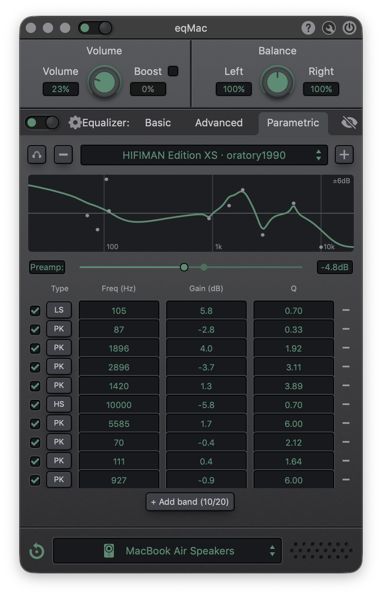

# eqMac 1.9.2: local build with a parametric EQ

A personal fork of [eqMac](https://github.com/bitgapp/eqMac) v1.9.2, the open-source system-wide audio equalizer for macOS. It builds on current macOS and Xcode, adds a parametric equalizer with built-in [AutoEq](https://github.com/jaakkopasanen/AutoEq) headphone presets, and has no update checks, crash reporting or analytics.

<p align="center">
  
</p>

## What's different from upstream

### Parametric EQ with AutoEq presets
- A third equalizer, **Parametric**, next to Basic and Advanced.
- **Bands:** up to 20, each with its own filter type (peak, low shelf or high shelf), frequency, gain and Q. Each band can be switched on or off.
- **Preamp** control.
- **Response graph:** a live frequency-response curve with a dot for each band.
- **AutoEq search:** search the AutoEq database (about 8,800 measurements) by brand and model, for example `hd650` or `athm50x`, and load a result as a preset with one click. When a headphone has several measurements, the preferred source (oratory1990, crinacle, …) is listed first.
- **Import and export:** import Equalizer APO / AutoEq `ParametricEQ.txt` files, and import or export presets as JSON.
- **Accuracy:** the filters match the reference (RBJ) biquad response within 0.01 dB at 44.1, 48 and 96 kHz.

### No phoning home
- **Removed:**
  - The Sparkle update checker and auto-updater.
  - The "over-the-air" downloads of a newer UI.
  - Sentry crash reporting.
  - Google Analytics and the privacy prompt.
  - The bug-report link.
- **Only network access left:** downloading the AutoEq index and presets from GitHub, and only when you use AutoEq. The index is cached for 7 days.
- **UI source:** the app always uses the UI bundled inside it.

### Everything unlocked
- **Sections always shown:** volume and boost, balance, all equalizers and output selection.
- **No feature toggles:** they can't be hidden or disabled.

### Fixes
- **Build:** builds with Xcode 27 and the current macOS SDK. Removed or deleted dependencies were vendored or dropped.
- **Driver crash:** the audio driver no longer crashes the Core Audio helper on Macs with memory tagging (MTE).
- **Quit crash:** quitting without the driver device no longer crashes.
- **Window buttons:** the native macOS window buttons no longer show next to the app's own.

## Building

Requirements:
- **Xcode:** full Xcode in `/Applications`.
- **Other tools:** CocoaPods, Node and Yarn.

```sh
./build.sh                    # UI + app + driver, Release, ad-hoc signed
./build.sh --skip-ui          # reuse the last UI build
./build.sh --install-driver   # also install the audio driver (asks for your password)
```

The app and driver are written to `build/Build/Products/Release/`.

- **Driver version:** this app only works with the driver it builds (version 1.3.x). A driver from a newer eqMac release is reported as incompatible. Installing this one replaces it.
- **Signing:** builds are ad-hoc signed, so they run on the Mac that built them.

See [LOCAL-BUILD-NOTES.md](LOCAL-BUILD-NOTES.md) for:
- Every change from upstream, and why it was made.
- How to install the driver by hand.
- Known limitations and debugging tips.

## Architecture

- **[App](native/app):** the native Swift app. It handles audio processing, the equalizers, window management and the bridge to the UI.
- **[UI](ui):** an Angular + TypeScript interface. It runs in a web view and is bundled inside the app.
- **[Driver](native/driver):** a user-space Core Audio driver. It captures system audio and passes it to the app.

## Credits

- [@nodeful](https://github.com/nodeful) and [bitgapp](https://github.com/bitgapp): creators of eqMac.
- [Jaakko Pasanen](https://github.com/jaakkopasanen): [AutoEq](https://github.com/jaakkopasanen/AutoEq). The headphone measurements come from oratory1990, crinacle, Rtings and the other sources it credits.
- [Max Heim](https://github.com/0bmxa): [Pancake](https://github.com/0bmxa/Pancake), the first Swift Audio Server plug-in driver.
- [@titanicbobo](https://github.com/titanicbobo): the Big Sur [icon design](assets/icon/icon.svg).

This fork is not affiliated with or supported by bitgapp. Report problems with it here, not upstream.

## License

[Apache License 2.0](LICENSE), same as upstream.
